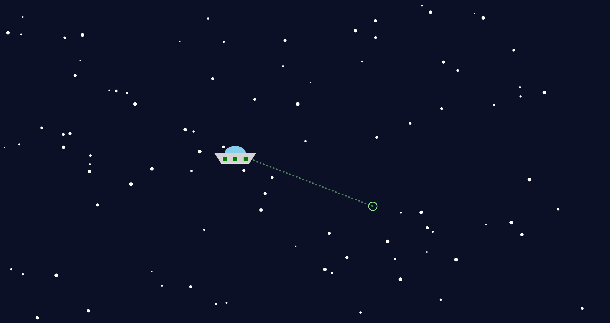

GitHub Pages: https://julian-kreis.github.io/a1-ghd3/

My project is a simple, interactive UFO flying through space animation. The UFO moves to follow the mouse. The speed and size of the UFO and stars are all scaled to the starting screen size.

References:
Copied starter code from
https://d3js.org/getting-started

AI Usage:
Used AI to provide examples of how to draw different shapes and how to update the positions of the shapes within an animation loop